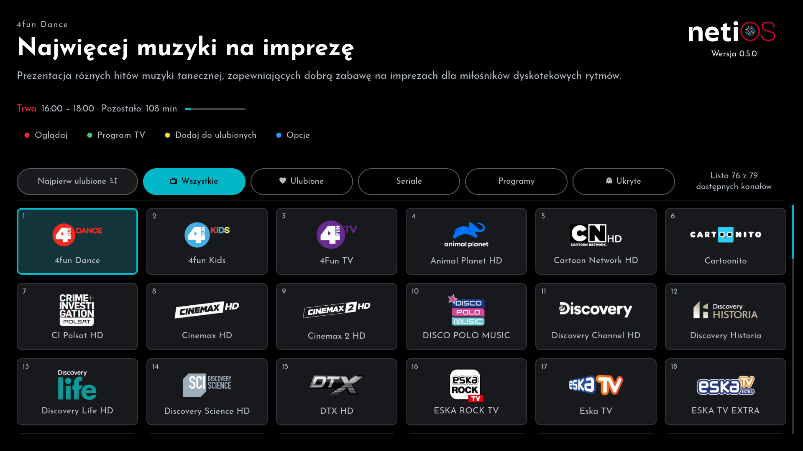
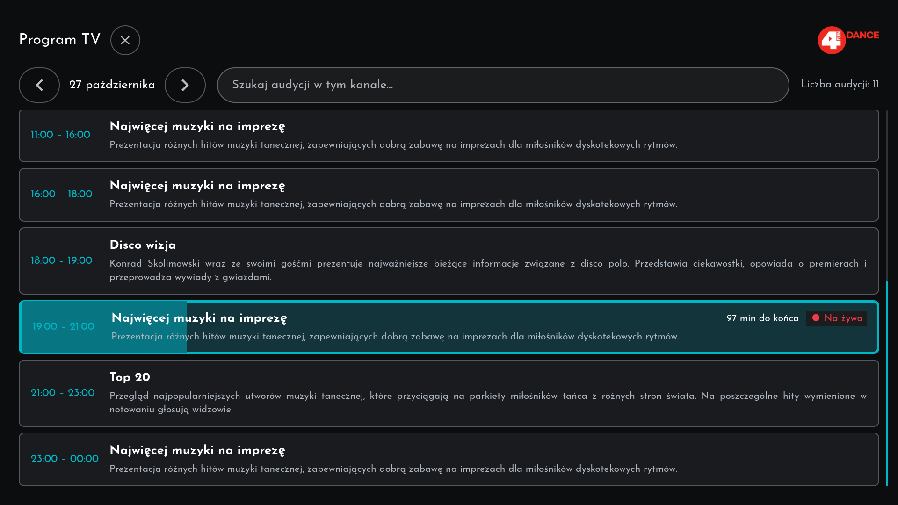
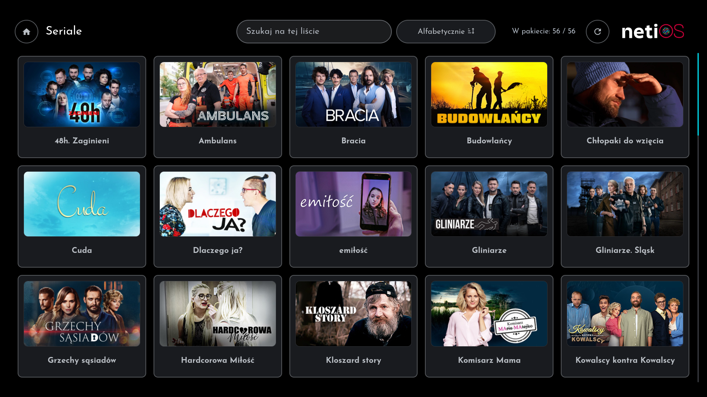
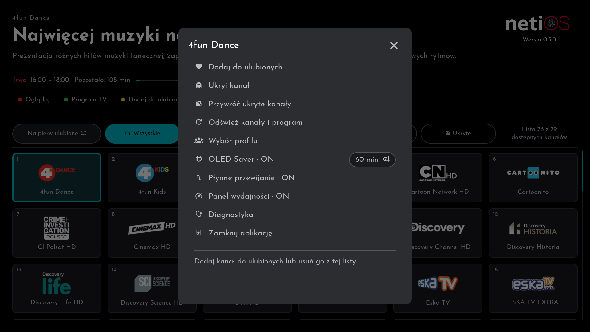

<p align="center"></p>

# netiOS

Nieoficjalny klient Netia GO dla telewizorów LG z webOS 4 i nowszym. Wymagany abonament w Netii. Automatyczny dobór kanałów, programów i seriali dostępnych w ramach wykupionego pakietu.
Zero crapu, reklam i innego badziewia. Ciesz się ponad 200 odcinkami "Demakijażu" Ibisza, "Pamiętnikami z wakacji", "Zdradami" i innymi hitami z uniwersum polslopu!
Funkcja OLED Saver automatycznie włączy wygaszacz ekranu wszystkim używającym TV jako maszyny grającej i uchroni matrycę przed wypaleniem pasku TV Republiki, TVNu czy co tam oglądacie.

## Najważniejsze funkcje

1. **Logowanie na telewizorze** — oficjalny formularz Netii, klawiatura LG i opcjonalne szyfrowane zapamiętanie danych.
2. **Profile** — wybór profilu, profil domyślny i automatyczny wybór jedynego profilu.
3. **Kanały w pakiecie** — logotypy, ulubione, ukryte, sortowanie alfabetyczne, tematyczne lub z ulubionymi na początku; lista zapamiętana między uruchomieniami.
4. **Odtwarzacz DASH/Widevine i MP4 VOD** — najwyższa dostępna jakość na start, wybór jakości, audio i napisów, cofanie w buforze Netii.
5. **Program TV, Seriale i Programy** — ramówka z granicami dni, katalogi z sezonami i opisami, zapamiętane listy i miniatury.
6. **Pilot i opcje** — Natywna obsługa Magic Remote, płynne przewijanie, numery kanałów, kolorowe skróty, diagnostyka, panel wydajności i OLED Saver.

## Zrzuty ekranu

Zrzuty z telewizora LG (webOS 5). Logotypy, nazwy kanałów, opisy i grafiki należą do Netii i dostawców treści.






## Budowanie

Na komputerze: Node.js 22.22.2+, 24.15.0+ lub 26+ oraz npm 12.2.1. Instalacja korzysta z npm 12, które pomija shrinkwrap dostawcy CLI i respektuje poprawki bezpieczeństwa zależności. Nie wymaga to zmiany globalnego npm; użyj polecenia npx poniżej. OpenSSH jest potrzebne do opcjonalnych narzędzi TV. Testy UI i renderer grafik wymagają Brave; niestandardową ścieżkę można ustawić przez BRAVE_EXECUTABLE.

```sh
npx --yes npm@12.2.1 ci
npm test
npm run build
npm run test:ui
npm run licenses
npm run release
```

Każda kolejna paczka testowa zawierająca zmiany otrzymuje nowy numer wersji. Build sprawdza zgodność numerów aplikacji, usługi i npm.

Pakiet po buildzie: `dist/com.netiago.webos_0.6.0_all.ipk`. Lokalny eksport release trafia do dist/release. Ten sam katalog zawiera manifest Homebrew, przezroczystą ikonę i SHA256SUMS. Publikuj wyłącznie sprawdzone artefakty; cały katalog roboczy zawiera prywatne materiały wyłączone z Git. Polecenie release tworzy też czyste repozytorium źródłowe w `dist/github/netiOS` z neutralnym autorem i jednym zatwierdzeniem, bez starej historii i danych testowych.

Usługa TV jest zgodna z Node.js 8.12.0. Shaka Player 4.16.53, Josefin Sans, MDI i LG SDK są dołączane lokalnie wraz z licencjami. Budowanie wykorzystuje jawną listę plików aplikacji i usługi.

## Instalacja

**[Poradnik instalacji krok po kroku](docs/INSTALL.md)**: wymagania, instalacja i logowanie, ze zrzutami ekranu. Obejmuje webOS 4, gdzie logujesz się na komputerze, a narzędzie przenosi sesję na telewizor.

W skrócie: telewizor z rootem i Homebrew Channel (telnet lub SSH), komputer z Windows w tej samej sieci. Z wydania pobierz `netiOS-0.6.0-installer.zip` i uruchom:

- **`Install-netiOS.cmd`**: wyszukuje telewizory, instaluje dołączoną paczkę przez SSH lub telnet i czeka na potwierdzenie od systemu. Alternatywnie paczkę wgrasz przez [Glasshouse](https://github.com/rorygallagher2024/glasshouse).
- **`Import-Session.cmd`** (webOS 4): otwiera stronę logowania Netia GO w przeglądarce na komputerze; po zalogowaniu przenosi sesję na telewizor.
- **macOS:** `install-netios.command` instaluje aplikację, a `Import-Session.command` (eksperymentalnie) przenosi sesję. Za pierwszym razem: prawy przycisk → Otwórz.

Aktualizacje przez Homebrew Channel: w ustawieniach Homebrew Channel dodaj repozytorium `https://raw.githubusercontent.com/magoowa/netiOS/main/homebrew/repo.json`. Homebrew Channel nie udostępnia sposobu na dodanie repozytorium z zewnątrz, dlatego ten krok jest ręczny i jednorazowy.

Ręcznie: zainstaluj IPK przez Homebrew Channel lub zgodny instalator, np. webOS Dev Manager. Telewizor potrzebuje działającego Homebrew albo LG Developer Mode; aplikacja nie potrzebuje uprawnień root w trakcie pracy. Publiczne repozytorium Homebrew musi wskazywać hostowany manifest; IPK, manifest i ikona muszą być dostępne razem.

## Sterowanie i konto

Krótki OK na kafelku włącza kanał po puszczeniu przycisku, bez dodatkowego oczekiwania. Kliknięcie wskaźnikiem działa od razu. Czerwony ogląda, zielony otwiera Program TV, żółty zmienia ulubione, niebieski otwiera Opcje. Numery są względne wobec aktualnej listy; wpisywanie kończy się po 1,5 s lub po OK.

Logowanie odbywa się na TV. Opcja „Zapamiętaj dane logowania” zapisuje zweryfikowany login i hasło w AES-256-GCM. Wylogowanie usuwa zapisane hasło i uwierzytelnienie, pozostawiając zaszyfrowaną podpowiedź loginu/profilu. Zamknięcie lub utrata fokusu nie wylogowuje. Root TV może odczytać lokalny klucz: nie jest to sprzętowy magazyn kluczy. Szczegóły: [bezpieczeństwo](SECURITY.md).

Sortowanie kanałów: Alfabetycznie (naturalna kolejność liczb w nazwach, np. 2 przed 10), Tematycznie oraz Najpierw ulubione. Każda lista (Wszystkie, Ulubione, Ukryte) pamięta własny wybór.

OLED Saver ma niezależny przełącznik ON/OFF i czas 30/60/90/120 minut bezczynności podczas oglądania TV. Wygaszacz pauzuje obraz; dowolny przycisk przywraca oglądanie. W Opcjach można też włączyć płynne przewijanie list oraz panel wydajności (FPS, obciążenie procesora i pamięć RAM telewizora).

## Edycja i narzędzia

- [Teksty interfejsu](app/strings.json), [wspólny CSS](app/style.css).
- [Konfiguracja i lista kanałów](docs/USER_CONFIGURATION.md); neutralny wzór: [user-config.example.json](config/user-config.example.json). Prawdziwy plik jest wyłączony z Git i nie zawiera danych logowania.
- Opcjonalny injector: `node tools/inject-login.cjs` wykrywa TV przez SSDP, pyta o login/ukryte hasło i przesyła je tunelem SSH. Uwierzytelnienie pozostaje w oficjalnym iframe na TV. Wymaga root SSH i istniejącego inspektora na loopback 9998; nie włącza debugowania systemu. Telnet nie jest używany.
- [Historia zmian](CHANGELOG.md), [testy](docs/TESTING.md), [publikacja wydania](docs/PUBLICATION.md).

## Zgodność i ograniczenia

Sprawdzono na webOS 5 (Chromium 68), w tym odtwarzanie chronionych kanałów w 1080p. Pozostałe generacje webOS wymagają testów. Liczba kanałów zależy od uprawnień konta i profilu.

Niektóre kanały mogą odmówić licencji lub odtwarzania mimo widoczności w pakiecie. Wymagane PIN-y rodzicielskie i polityki CAC nie są obsługiwane i powodują jawną odmowę. Interaktywna weryfikacja CAPTCHA oraz długotrwałe odświeżanie sesji wymagają dalszych testów. Najwyższa jakość może buforować przy słabym łączu; dostępne jest Auto.

Brak powiązania z oficjalnym wydawcą Netia GO.

## Technologie zewnętrzne i licencje

| Składnik | Zastosowanie | Licencja / warunki |
|---|---|---|
| Shaka Player 4.16.53 | MPEG-DASH, adaptacyjny bitrate, audio, napisy i integracja EME/Widevine | Apache-2.0; pełny tekst w IPK: app/vendor/SHAKA-LICENSE |
| LG webOSTV.js | Most do API systemowych webOS | [Apache-2.0](app/assets/licenses/WEBOSTV-LICENSE) |
| Material Design Icons 7.4.47 / Pictogrammers | Ikony SVG | [Pictogrammers Free License](app/assets/licenses/MDI-LICENSE): ikony Apache-2.0, kod pomocniczy MIT |
| Josefin Sans | Lokalne fonty i typografia logo | [SIL Open Font License 1.1](app/assets/licenses/JOSEFIN-LICENSE) |
| Node.js | Usługa aplikacji na TV i narzędzia komputerowe | [MIT oraz licencje składników dołączonych do Node.js](https://github.com/nodejs/node/blob/main/LICENSE) |
| LG webOS / Chromium / Web APIs | Środowisko TV, HTML/CSS/JavaScript, WebCrypto, MediaSource i EME | webOS na warunkach LG; Chromium BSD-style i licencje jego zależności. System ani silnik TV nie są częścią IPK |
| Google Widevine CDM | Odtwarzanie treści chronionych przez system TV | Własnościowe warunki Google/LG; CDM nie jest dołączany do IPK |
| API, materiały i znaki Netia GO | Kanały, ramówka, katalogi i grafiki konta użytkownika | Prawa Netii i dostawców treści; wymagane uprawnienia konta, materiały nie są częścią dystrybucji kodu |

Narzędzia developerskie nie są instalowane na TV razem z aplikacją.

| Narzędzie | Zastosowanie | Licencja / źródło |
|---|---|---|
| @webos-tools/cli 3.2.6 | Pakowanie IPK | Apache-2.0, według package.json i LICENSE zainstalowanego pakietu |
| Playwright 1.64.1 | Regresje UI i renderowanie grafik | Apache-2.0, według package.json i LICENSE zainstalowanego pakietu |
| Chromium | Przeglądarka uruchamiana przez testy i branding | [Brave MPL-2.0](https://github.com/brave/brave-browser/blob/master/LICENSE), Chromium BSD-style oraz licencje składników; nie są pakowane do IPK |
| npm 12.2.1 | Instalowanie zależności i skrypty | [Artistic-2.0 z dodatkowymi warunkami npm](https://docs.npmjs.com/policies/npm-license/) |
| Git | Historia kodu i lokalny eksport wydania | [GPL-2.0](https://git-scm.com/about/free-and-open-source) |
| OpenSSH | Opcjonalne narzędzia konfiguracji i logowania na TV | [Licencje BSD-style / warunki składników OpenSSH](https://www.openssh.org/features.html) |
| Homebrew Channel | Opcjonalna instalacja i testy na TV | [MIT](https://github.com/webosbrew/webos-homebrew-channel/blob/main/LICENSE); osobny program, nie jest dołączany do IPK |
| webOS Dev Manager | Alternatywny, opcjonalny instalator IPK | [Apache-2.0](https://github.com/webosbrew/dev-manager-desktop/blob/main/LICENSE); osobny program, nie jest dołączany do IPK |
| Python 3 | Opcjonalne ponowne generowanie QR | [PSF License i licencje składników Pythona](https://docs.python.org/3/license.html) |
| ReportLab 4.4.9 / QR encoder | Generator SVG kodu QR profili | [ReportLab: BSD](https://docs.reportlab.com/developerfaqs/#13-licensing); qrencoder.py: MIT, Copyright Open End AB / Kazuhiko Arase |

[Pełny wykaz zależności npm i ich licencji](docs/THIRD-PARTY.md) obejmuje również zależności pośrednie oraz opcjonalne z package-lock.json. Licencje bibliotek nie określają warunków korzystania z Netia GO ani nie nadają licencji kodowi własnemu netiOS. W repozytorium nie zadeklarowano jeszcze osobnej licencji kodu własnego.
