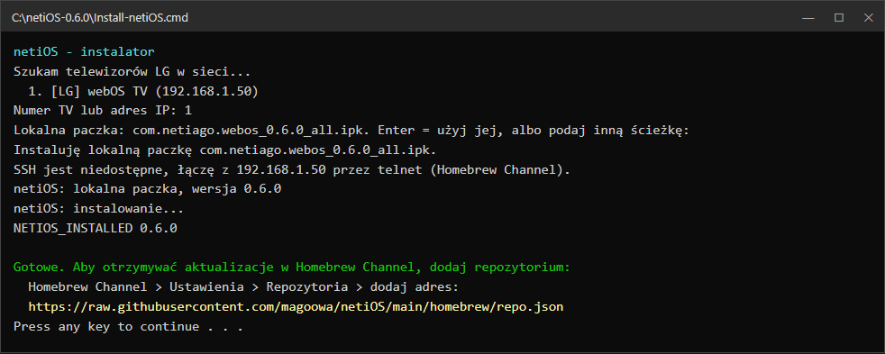
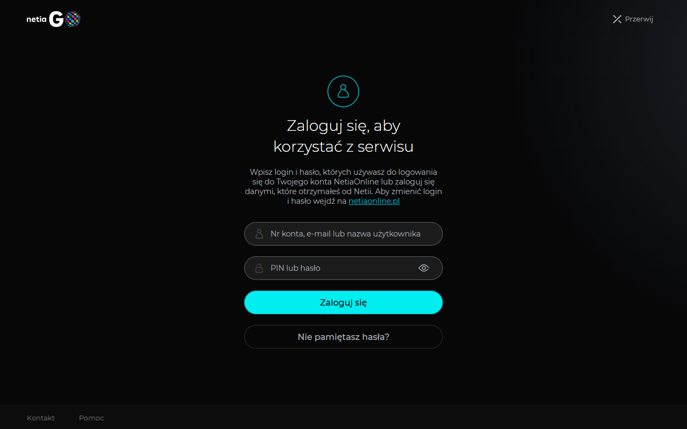
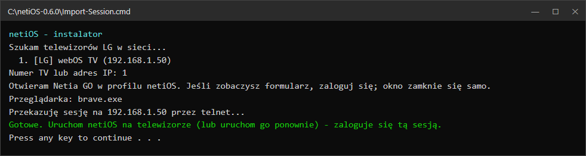

# Instalacja netiOS

Ten poradnik prowadzi krok po kroku przez instalację netiOS na telewizorze LG, zaczynając od **webOS 4**. To najtrudniejszy przypadek: przeglądarka webOS 4 (Chromium 53) nie potrafi uruchomić oficjalnego formularza logowania Netia GO, więc logujesz się na komputerze, a narzędzie przenosi tę sesję na telewizor.

Na webOS 5 i nowszych logowanie odbywa się bezpośrednio na telewizorze, w oficjalnym formularzu Netii. Wystarczą kroki 1–3, a krok 4 możesz pominąć.

## 1. Wymagania

### Telewizor

- LG z systemem **webOS 4.x** lub nowszym. Sprawdzone: OLED55C9 (webOS 4.10) i webOS 5.6.
- **Root i [Homebrew Channel](https://github.com/webosbrew/webos-homebrew-channel)**. Sposób zrootowania zależy od modelu i wersji oprogramowania; opisuje go społeczność [webosbrew](https://www.webosbrew.org/).
- W ustawieniach Homebrew Channel włączony **telnet** albo **SSH**. Instalator sam wybiera SSH, a gdy jest wyłączone, używa telnetu.
- Aktywne konto i pakiet **Netia GO**.

### Komputer

- **Windows 10 lub 11**. Narzędzie korzysta z wbudowanego PowerShella, niczego nie trzeba doinstalowywać.
- Przeglądarka oparta na Chromium: **Chrome, Edge, Brave, Opera lub Vivaldi**. Narzędzie używa domyślnej, jeśli jest jedną z nich, a w innym wypadku pierwszej zainstalowanej.
- **macOS** (wersja eksperymentalna): `install-netios.command` instaluje aplikację, a `Import-Session.command` przenosi sesję. Nie wymaga instalowania niczego dodatkowego.

### Sieć

- Telewizor i komputer w **tej samej sieci lokalnej**.
- Komputer musi mieć dostęp do telewizora na porcie **23** (telnet) lub **22** (SSH), a podczas instalacji także na porcie **5599**, którym paczka trafia na TV.
- Telewizor potrzebuje internetu do Netii; komputer potrzebuje go tylko do zalogowania się na go.netia.pl.
- Na komputerze nie trzeba otwierać żadnych portów: to komputer łączy się z telewizorem, nie odwrotnie.

## 2. Pobranie

Z zakładki [Releases](https://github.com/magoowa/netiOS/releases) pobierz `netiOS-0.6.4-installer.zip` i rozpakuj go, np. do `C:\netiOS-0.6.4`. W środku jest paczka `com.netiago.webos_0.6.4_all.ipk` i narzędzia:

| Plik | Do czego |
| --- | --- |
| `Install-netiOS.cmd` | Instaluje netiOS na telewizorze (Windows). |
| `Import-Session.cmd` | Przenosi sesję Netia GO z komputera na telewizor z webOS 4. |
| `install-netios.command` | Instalacja z macOS. |
| `Import-Session.command` | Przeniesienie sesji z macOS (eksperymentalne). |

## 3. Instalacja aplikacji

### Zalecane: Glasshouse

[Glasshouse](https://github.com/rorygallagher2024/glasshouse) to panel do zrootowanych telewizorów LG, działający na samym telewizorze i obsługiwany z przeglądarki. Ma na liście przetestowanych modeli m.in. serię C9.

**Na webOS 4 zalecana jest wersja Glasshouse [0.118.0](https://github.com/rorygallagher2024/glasshouse/releases/tag/v0.118.0).**

1. Zainstaluj Glasshouse według jego [instrukcji instalacji](https://rorygallagher2024.github.io/glasshouse/install/) (`./deploy.sh <adres-IP-TV>` z katalogu `server/`). Na webOS 4 użyj wersji 0.118.0: pobierz ją z [wydania v0.118.0](https://github.com/rorygallagher2024/glasshouse/releases/tag/v0.118.0) albo po sklonowaniu repozytorium przełącz się na nią poleceniem `git checkout v0.118.0`.
2. Otwórz w przeglądarce `http://<adres-IP-TV>:8080/`.
3. W zakładce **Apps** włącz **Install app from a URL or file**, wybierz **Upload .ipk** i wskaż `com.netiago.webos_0.6.4_all.ipk`. Szczegóły są w [opisie zakładki Apps](https://rorygallagher2024.github.io/glasshouse/dashboard/apps/).

### Alternatywnie: instalator netiOS

Kliknij dwukrotnie `Install-netiOS.cmd`. Instalator:

1. wyszukuje telewizory LG w sieci i pokazuje listę: wpisz numer telewizora albo jego adres IP;
2. proponuje paczkę leżącą obok: naciśnij Enter;
3. łączy się z telewizorem (SSH, a gdy jest wyłączone, telnet), przesyła paczkę, instaluje ją i czeka na potwierdzenie od systemu;
4. kończy komunikatem `NETIOS_INSTALLED 0.6.4` i uruchamia netiOS.



*Prawdziwy przebieg instalatora; nazwa i adres telewizora zastąpione przykładowymi.*

Jeśli SSH jest włączone, instalator poprosi o hasło użytkownika root (w Homebrew Channel domyślnie `alpine`). Przy telnecie hasła nie ma.

## 4. Logowanie na webOS 4

Na webOS 4 oficjalny formularz Netii nie działa na telewizorze, więc logujesz się raz na komputerze.

1. Kliknij dwukrotnie **`Import-Session.cmd`** i wybierz telewizor tak jak przy instalacji.
2. Otworzy się okno przeglądarki ze stroną logowania Netia GO. Zaloguj się w nim **normalnie**, swoim loginem i hasłem, tak jak na stronie Netii. Jeśli Netia pokaże weryfikację (captcha), rozwiąż ją jak zwykle.

   

3. Po zalogowaniu okno zamknie się samo. Narzędzie odczytuje z niego sesję Netii i przesyła ją na telewizor przez telnet albo SSH. Hasło nie jest nigdzie zapisywane ani przesyłane: na telewizor trafia tylko sesja.

   

   *Prawdziwy przebieg; nazwa i adres telewizora zastąpione przykładowymi.*

4. Uruchom netiOS na telewizorze (albo uruchom go ponownie). Aplikacja zaloguje się tą sesją i przejdzie do wyboru profilu, a potem do kanałów.

   

### Na Macu (eksperymentalnie)

Przebieg jest taki sam jak na Windows, tylko zamiast plików `.cmd` uruchamiasz `.command`:

1. Kliknij dwukrotnie **`Import-Session.command`**. Za pierwszym razem macOS może zablokować plik pobrany z internetu: kliknij go wtedy prawym przyciskiem, wybierz **Otwórz** i potwierdź.
2. Wybierz telewizor, zaloguj się w oknie przeglądarki (Chrome, Brave, Edge, Vivaldi lub Opera), a okno zamknie się samo.
3. Gdy w Terminalu pojawi się „Gotowe”, uruchom netiOS na telewizorze.

Ta wersja nie była jeszcze sprawdzona na prawdziwym Macu. Jeśli coś pójdzie nie tak, zrób zdjęcie okna Terminala i zgłoś problem.

Jak to działa na co dzień:

- Przeglądarka używa osobnego profilu netiOS (Windows: `%LOCALAPPDATA%\netiOS\login-<przeglądarka>`, macOS: `~/Library/Application Support/netiOS/`), więc twój zwykły profil zostaje nietknięty. Możesz w nim zapamiętać hasło; przy kolejnym imporcie okno zwykle tylko mignie.
- Sesja Netii jest ważna przez kilka miesięcy. netiOS używa jej przy każdym uruchomieniu, aż wygaśnie, Netia ją odrzuci albo wylogujesz się w aplikacji. Wtedy wystarczy ponownie uruchomić `Import-Session.cmd`.
- **Nie wylogowuj się na go.netia.pl w profilu netiOS w swojej przeglądarce**: wylogowanie zamyka także sesję na telewizorze. Zwykłe zamknięcie okna niczego nie psuje.

## 5. Aktualizacje

W Homebrew Channel dodaj repozytorium:

```
https://raw.githubusercontent.com/magoowa/netiOS/main/homebrew/repo.json
```

Homebrew Channel pokaże wtedy nowe wersje netiOS. Możesz też po prostu uruchomić instalator z nowszego wydania.

## 6. Problemy

| Objaw | Co zrobić |
| --- | --- |
| Instalator: „TV nie odpowiada na SSH (22) ani telnet (23)” | Włącz telnet lub SSH w ustawieniach Homebrew Channel; sprawdź, czy TV i komputer są w tej samej sieci. |
| Instalator: „Instalacja nie powiodła się” z komunikatem systemu | Komunikat pochodzi z instalatora webOS; najczęściej brakuje miejsca albo Homebrew Channel nie ma uprawnień root. |
| webOS 4: aplikacja stoi na „Wczytywanie oficjalnego formularza” | Sesja nie dotarła albo wygasła: uruchom ponownie `Import-Session.cmd`, potem netiOS. |
| Coś nie działa po zalogowaniu | Dziennik logowania na TV: `cat /media/internal/com.netiago.webos/login.log` (przez telnet lub SSH). Zawiera tylko nazwy wywołań, wyniki i kody błędów, bez haseł i tokenów. |
